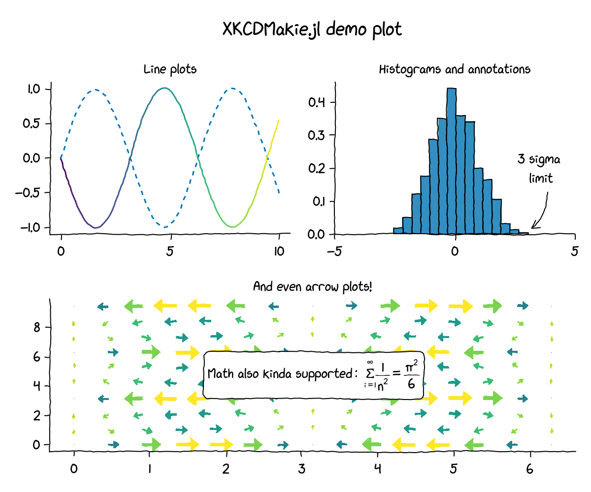
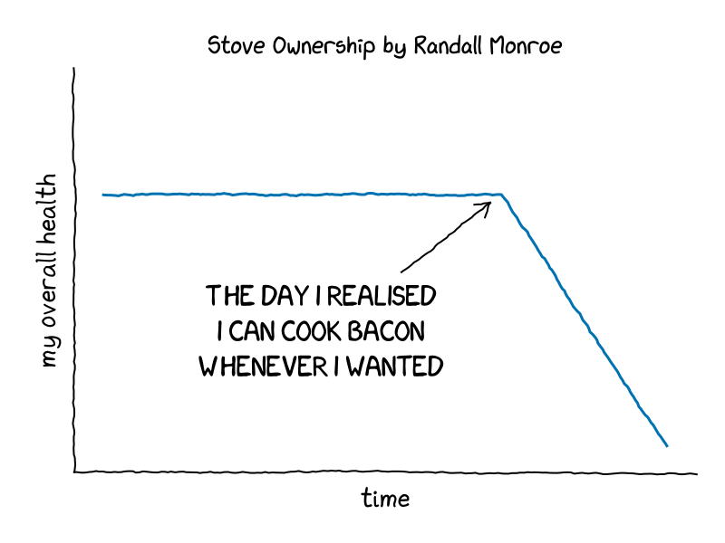
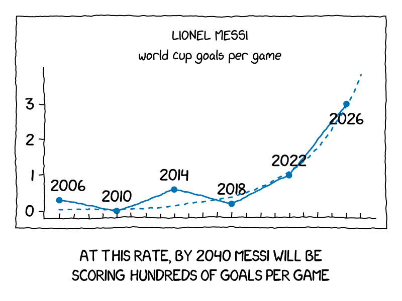
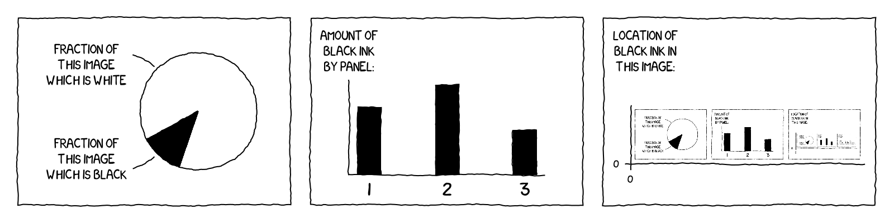

# XKCDMakie.jl

> Finally, a worthy competitor to Matplotlib's `xkcd` mode

The title speaks for itself: an extremely crude hack into [Makie.jl](https://github.com/MakieOrg/Makie.jl) that makes the plots look more hand-drawn. As of now works only with the CairoMakie backend.

Uses the authentic [xkcd font](https://github.com/ipython/xkcd-font/tree/master) ([CC BY-NC 3.0](https://creativecommons.org/licenses/by-nc/3.0/)).

Paste it into your REPL to install:
```julia
using Pkg; Pkg.add("XKCDMakie")
```
or
```
]add XKCDMakie
```

Use it the same way you use `CairoMakie`. 

## Configuration

You can use [Makie theme mechanism](https://docs.makie.org/dev/explanations/theming/themes) to configure the look of the plots. The theme responsible for this look-and-feel is `theme_xkcd`, which allows you to configure the following:
- `gridvisible`: visibility of the grid (default: false)
- `min_dist`: accuracy of hand-drawn line emulation. Lower is more precise, but heavier to compute (default: 3)
- `noise_generator`: the noise sampler that is responsible for hand-drawn line emulation (see [CoherentNoise.jl](https://github.com/lazarusA/CoherentNoise.jl)).

> [!note]
> The font in LaTeX notation cannot be controlled by Makie themes, and custom fonts are not fully supported by the backend. 
> 
> XKCDMakie provides experimental support, but it is manually opt-in: use `XKCDMakie.enable_math!()` and `XKCDMakie.enable_math!()`

## Gallery

All images in this gallery were generated using this package. You can find the code in the [`contrib/`](contrib/) directory.



**Disclaimer:** these works below belong to Randall Munroe, I only adapted them to XKCDMakie.

| [Stove Ownership](https://xkcd.com/418/) | [Messi](https://xkcd.com/3260/) |
| --- | --- |
|  |  |

| [Self-Description](https://xkcd.com/688/) |
| --- |
|  |
